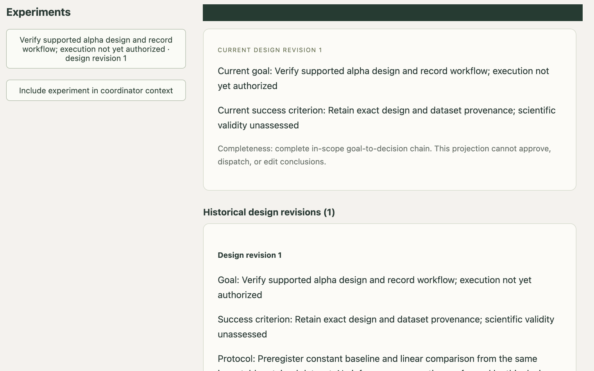
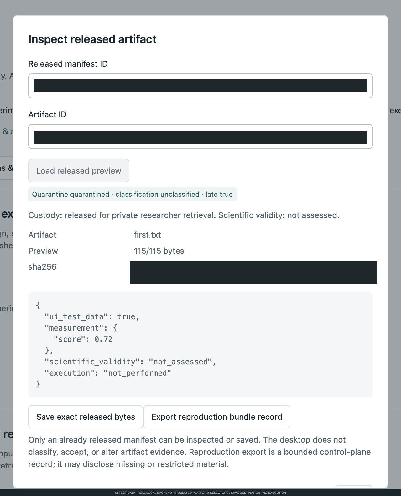
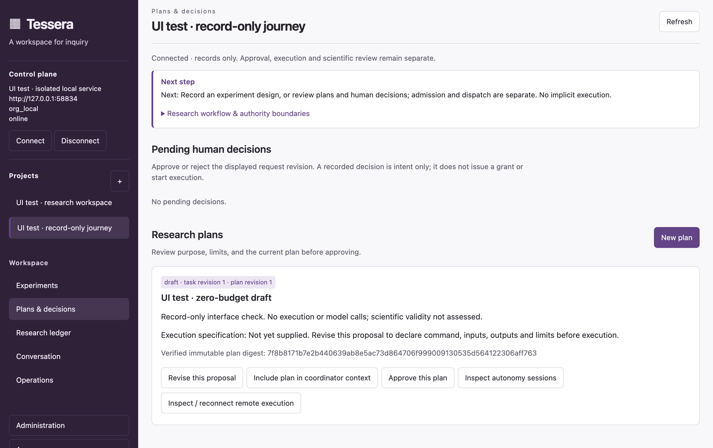

# Tessera

**Run agent-assisted experiments. Keep a scientist’s record.** Tessera is being
built for computational researchers and research engineers who already have
scripts or notebooks, data, and access to compute—and want to delegate experimental
work without losing control of the method, access, cost, or conclusions.

An agent can suggest a change or produce an output; the harder research questions
are what was actually run, how it differed from the baseline, what the evidence
supports, and why you chose the next step. Tessera connects plans, permissions,
execution attempts, evidence and human decisions in a durable research ledger.
The investigation—not a chat session—is the unit you should be able to return to.

**Developer alpha · local evaluation, not a production platform.** The supported
starting point is a local control service and desktop client, with bounded CPU
execution through the maintained local Docker path (`docker-local-cpu-v1`, plus
campaigns). The Kubernetes lab profile is optional and frozen
([ADR 0033](docs/decisions/0033-freeze-over-built-planes.md)). General remote
execution, integrated agent reasoning and scientific acceptance are not demonstrated.

## From a research question to a defensible next step

Consider a tabular prediction experiment: does a proposed feature transformation
improve on the existing baseline, using the same data split and evaluation method?
The **intended agent-assisted workflow** is:

1. **Establish the question and baseline.** Identify the script, input snapshot,
   environment, metric and success criterion before changing the experiment.
2. **Review one bounded intervention.** Let an agent propose the change and checks;
   you review the exact plan, approved compute target, data access, cost/exposure
   limits, deadline and stop rules. A proposal is not permission to run.
3. **Follow the attempt.** Inspect progress, outputs and failures rather than
   relying on a reassuring summary. Keep a failed run distinct from a valid
   negative or inconclusive result; record changes of plan rather than silently
   replacing the original method.
4. **Stop and return.** Request a stop when needed and distinguish the request from
   confirmed termination. Revisit the same investigation to inspect what happened
   and what remains unresolved; returning to its history should not rerun work.
5. **Review the evidence and decide.** Compare baseline and intervention, check the
   method and uncertainty, and record whether to continue, revise or reject the
   idea—with links to the supporting and opposing evidence.

The aim is less reconstruction across chats, scripts and result folders, and a
clearer account of what you knew when you made a decision. **Traceability is not
scientific validity:** a complete record, successful process or agent critique
does not establish that the method is sound or the conclusion is justified.

This end-to-end agent workflow is a design target, **not today's integrated alpha**.
Today you can use the local desktop/control service for versioned designs, studies,
linked measurements, a baseline-versus-intervention comparison of the recorded numbers
(difference, sample sizes and a 95% interval, never a verdict), human conclusions/corrections
and exports. Bounded CPU execution
uses a separate API/operator handoff; integrated planning, execution and agent
critique remain unverified. See [capabilities and limits](docs/implemented-capabilities.md)
for the implemented boundaries and the [tabular starter](docs/tabular-starter.md)
for the bounded baseline/intervention path. The intended compute target can be
outside the laptop, but demonstrated laptop-local execution does not prove
independent-host or laptop-off operation.

## A look inside

Actual Electron renderer and real isolated local backend with explicitly synthetic
UI test records. The credential picker is substituted; **no experiment execution
or model calls**. Scientific validity is not assessed. These renderer captures
are not native OS-picker proof.

### Record the experiment design



An immutable design records intent, not execution authority. Provenance and prior
designs remain available without crowding the current research question.

### Keep uncertain observations visible



Historical failure and current uncertainty remain attributed to human-reported
observations. No operation or scientific success is inferred from these records.

### Separate proposals from authority

Research MCP reads use `tessera_list_research_proposals` and
`tessera_read_research_proposal` for project/study/experiment proposals, including
immutable payload/digest and promotion state. The legacy `tessera_list_proposals`
and `tessera_read_proposal` tools cover task-plan proposals only. Both families
require scoped read authority; reading never promotes a proposal or permits execution.



The test draft survives reload and reconnect without replay. Drafting and human
approval remain distinct from execution admission, dispatch and scientific review.

## What you can evaluate today

The [quickstart](docs/quickstart.md) follows this bounded local journey. Execution
is a separate API/operator handoff, not a one-click desktop operation. The desktop has
admit, dispatch-authorize and resolve forms for the frozen Kubernetes lab path
(`desktop/EXECUTION.md`); its dispatch profile is a fixed lab profile, not derived from targets.


### Agent-assisted research: components, not an integrated demonstration


Proposal/review records and the opt-in [direct Agent Sandbox adapter](docs/agent-sandbox.md)
have isolated component tests. The adapter targets upstream **v1.0.6** one-shot,
network-none Sandboxes (an opt-in allowlist egress-proxy profile exists, see ADR 0034); it does not replace batch Jobs. No live CRD/controller or
Sandbox runtime acceptance is claimed. Warm pools, read-only source integration,
input/reasoning credential delivery and a complete agent reasoning/critique loop
are not available in this demonstrated journey.

### Campaigns (ADR 0038)

A session can submit a typed [campaign spec](docs/campaigns.md): a digest-pinned DAG of
stages with a budget cap, retries for transient failures (including an opt-in, bounded automatic
retry when the infrastructure killed the container or the stage stopped on a resource limit,
counted in the approved digest and worst-case exposure,
[ADR 0058](docs/decisions/0058-infrastructure-retry-of-stages.md),
[ADR 0067](docs/decisions/0067-resource-limit-stops-are-infrastructure-retries.md)), data classes and stop
rules. One human approval of the exact digest lets the in-process runner drive every step
(including staging one stage's outputs into the next) through the existing checks. A
terminal campaign has an operational receipt, not a scientific verdict.

**Standing approvals and scheduled starts.** A human can instead make one decision for a
whole recurring or chained run: a [standing approval](docs/decisions/0042-standing-approvals-and-scheduled-campaign-starts.md)
binds one exact spec digest to explicit caps (starts, total budget, per-start budget,
interval, concurrency, a window of at most 30 days) and optional retries and a follow-on
campaign. The runner then starts campaigns inside those caps with no new approval per start.
Each start re-checks, in one transaction, that the creating credential is still live, the
digest, references, data classes and provider trust (which can only narrow), and the project
spend limits. A start is an ordinary campaign with an approval marked `standing_approval`
that names the standing approval, so it is audited and appears on the receipt. Only a human
creates or revokes one (agents cannot); revoking stops new starts, and running campaigns can
be cancelled separately. A standing approval grants nothing a human approval would not: the
same budget cap, expiry, data-class and trust checks apply, and it never resolves a Salad
review for a person. `tessera serve --no-campaign-scheduler` turns scheduled starts off.

**Grant lifetime.** A stage's execution grant must outlive its `max_duration_seconds` by a
settle margin, or the spec is refused with a clear reason. The runner starts a grant's
lifetime only when a provider slot is free (a worker's `worker_slots`, default one), so
queue time never eats it, and an expired campaign grant whose run has a confirmed exit and
a recorded cost is reconciled automatically (credited to the campaign's actor) so it cannot
hold a slot forever; it never settles without that evidence (see
[ADR 0048](docs/decisions/0048-grant-lifetime-and-slot-release.md)).

**Gates between campaigns and a program budget.** An approval (or a standing approval, on
every start) can carry an `unlock`: it names an earlier campaign in the same project and is
admitted only if that campaign has a recorded human gate `go`, or a platform-computed
paired-delta outcome (per-seed differences of typed metric records, with a confidence
interval) inside an allowed set that a human pre-registered. The check runs in the
admission transaction, fails closed on anything missing, unresolved or unpaired, and is
recorded on the receipt. A later human `no_go` vetoes further starts. The gate record is
human-only: agents and workers cannot write it, and a go counts only when a person's
session recorded it (an owner credential with an automation label cannot unlock). `tessera serve --program-budget FILE` adds an
operator cap on the money committed across campaigns; it only narrows the existing caps. See
[ADR 0045](docs/decisions/0045-campaign-gates-program-budget.md). A gate is a human
direction or an arithmetic outcome, never scientific acceptance. A v2 stage whose approved
spec declares `gate_evidence` (a human-created split lock, a seed and metrics, with retries
off) gets its split bound and its metrics recorded by the runner under that approval, so the
chain can run unattended ([ADR 0049](docs/decisions/0049-campaign-gate-evidence.md)); the
records are measured numbers, `not_assessed`, and the gate decision itself stays human. A requirement can also
carry a fail-closed `measurement` condition on one number in the earlier campaign's terminal
receipt; it narrows the go or outcome and never replaces it
([ADR 0051](docs/decisions/0051-measurement-unlock-predicate-and-go-authority.md)). By default
only a person's session records the go; `tessera serve --accept-automation-gate-go` lets an
operator also count an owner credential's labelled-automation go (the receipt keeps its class).
A v2 stage output of kind `evidence_rows` (per-variant, per-seed metric rows over a
pre-registered grid and split lock) is ingested by the platform itself, so a paired gate over a
stage that trains both arms needs no transcribed numbers
([ADR 0052](docs/decisions/0052-campaign-evidence-rows.md)).

**Sealed holdout scoring.** A v2 stage can be a final `evaluation` stage that runs the spec's
pinned scorer image on private labels from custody and records its metrics on the receipt. When
it declares a sealed `holdout` (a snapshot or artifact input pinned by content digest, and a
claim scope), the platform opens that partition at most once per project, digest and scope: the
runner records a durable claim after every stage it depends on succeeded and before the labels
are released to any worker, refuses every later claim (at submit, at approval and at the claim
itself), and keeps the claim as `scored` with its metric values or `spent`. Claims cannot be
deleted or reopened, a holdout stage is never requeued once its claim is open, and from then on
the partition is sealed from the first approval that declares it: no other stage receives it,
and no other campaign takes the holdout stage's outputs, as an artifact or a staged snapshot
(re-checked before every input release). The labels stay non-public, so they reach only registered, trusted
providers and never the public internet (ADR 0047). `tessera_campaign_holdout` and
`tessera_campaign_holdout_claims` read the claims; nothing reopens one
([ADR 0068](docs/decisions/0068-sealed-holdout-evaluation-stages.md)).

**Providers and chaining.** A v2 spec names a compute *provider* and *runtime* per stage, up
to 64 stages. `local-docker` is built in (`tessera-worker development-poll` supplies the
container execution; its memory and scratch limits and its container uid:gid are operator settings in the
poller config, never plan fields (a stage may request more scratch than the default only up to the
operator's ceiling, refused at admission when above it,
[ADR 0059](docs/decisions/0059-operator-scratch-ceiling.md)); on native Linux the container runs as the poller's own
uid:gid by default so the 0700 output workspace stays writable), `self-hosted` runs the same worker on a server you operate, and
`salad` stages are refused unless the operator supplies Salad profiles (a billable,
opt-in third-party path; a profile is a GPU class or a CPU-only container with operator rates, so a
stage that needs no GPU does not take one, [ADR 0062](docs/decisions/0062-salad-cpu-only-profiles.md)).
A local-docker CPU stage that reads pinned snapshot and pinned artifact inputs can list such a profile as an
`alternate_providers` candidate with `{"adapt": {"profile": NAME}}`: submit expands it, from the
stage and the operator's profile, into the explicit Salad workload a person approves by digest,
and refuses a stage over a Salad limit or with a non-allowlisted image, naming the exact profile
entry to add or the provider-trust entry to merge (provider trust stays the operator's explicit policy; images are
still operator-built and pinned by digest, Tessera builds none;
[ADR 0076](docs/decisions/0076-salad-cpu-stage-adapter-and-cpu-runtime.md),
[ADR 0077](docs/decisions/0077-campaign-prep-from-the-spec.md); fakes only, no live
Salad run of an adapted stage). A vendor is a plugin: the operator's
`--campaign-providers` file names it (entry point group `tessera.campaign_providers` or a
dotted module) and gives it a config section, so adding one never edits the runner.
Providers and their profiles are added, updated and listed through one validated, audited operation
(`tessera providers`, the control API and operator-enabled MCP tools; no secrets, credentials by
reference, unknown providers refused, [ADR 0081](docs/decisions/0081-validated-provider-registration.md)).
Through the API a human manages only its own organization's Salad profiles (checked against the
database), and deployment-wide entries (local-docker, self-hosted, plugins) need the deployment's root
owner. A change applies at the next start, and provider trust remains operator-edited.
Descriptors are validated at registration. `--provider-trust` sets which data classes each
provider's worker may receive (public only by default). With the owner-set mode
`all_registered_providers` (ADR 0047), agents and specs route any data class among the
configured, registered providers without a per-run approval; data never goes to the public
internet or an unregistered destination in any mode, because non-public inputs cannot use
egress or workload fetch hosts and every transfer is recorded on the receipt (the egress
proxy journals a tunnel when it is admitted and again at close, so an interrupted tunnel is
recorded with unknown bytes rather than missing, [ADR 0057](docs/decisions/0057-egress-tunnel-opened-record.md)). A stage input is a snapshot, the
declared output of an earlier stage (any provider), or an `artifact` pinned by campaign,
stage, output and sha256 from an earlier campaign (or a `receipt_output` reference to a value on a succeeded campaign's receipt, resolved and pinned at submit, [ADR 0080](docs/decisions/0080-campaign-inputs-from-a-predecessor-receipt.md)); every input and output is indexed in
`campaign_stage_io`. A stage may also list ordered `alternate_providers`; the runner then places
each attempt on the first candidate that is registered, enrolled for the project, trusted for the
stage's inputs, within the per-run cap and the remaining campaign and program budget, and has a free
slot, so independent stages run concurrently on different providers. Otherwise it waits or fails as
a single-provider stage would; it never picks a provider the approved spec does not list. The choice
and each skipped candidate's reason are on the receipt and in `tessera_get_campaign`, and
`tessera_steer_campaign_placement` can pin or exclude candidates. ADR 0058's reroute targets
are part of the same list, used only for an infrastructure retry ([ADR
0060](docs/decisions/0060-capacity-aware-stage-placement.md)). An operator rule in the provider file
can put a preferred provider (a Salad CPU or GPU profile) first for long, large-scratch or
`heavy`-tagged stages, among the candidates the spec already lists, with the host as fallback
([ADR 0070](docs/decisions/0070-salad-first-placement-preference.md)). With no matching rule, a built-in default policy orders a stage's approved alternates by what the stage declares (heavy work, by declared memory, expected runtime or tag, tries a remote CPU candidate first, GPU a remote GPU one, internet-fetching work keeps remote candidates last, and a stage with no such signal keeps the order its spec wrote), only among destinations the spec already lists, with every check intact and the decision on the receipt; the operator can turn it off ([ADR 0088](docs/decisions/0088-default-placement-by-stage-class.md)). Each attempt is settled once through
a single settlement path with a closed basis enum, and a finished or failed attempt releases its
hold immediately.
Outputs above 16 MiB, such as model weights, use chunked [large-artifact custody](docs/large-artifacts.md):
one sha256 over the whole file, 4 MiB chunks, bounded memory, and an operator-configurable
ceiling (default 8 GiB per artifact). A Salad stage's guardian input path follows the same bound and is tested against a fake control serving a virtual 3 GiB artifact; no live Salad pull of that size has been run, and a Salad stage's own outputs stay at 16 MiB.
Example systemd units for the poller, Salad executor and guardian are in
[`deploy/systemd`](deploy/systemd/README.md).

Clients direct campaigns through `tessera_mcp`: `tessera_submit_campaign` takes v1 and v2
specs (providers, artifact inputs, chaining); `tessera_list_campaigns`,
`tessera_get_campaign_receipt`, `tessera_list_snapshots`, `tessera_campaign_outputs`,
`tessera_campaign_logs`, `tessera_campaign_budget` and `tessera_project_spend` (the operator's
project limits and campaign totals) read recorded state under separate
scopes. Steering tools ([ADR 0055](docs/decisions/0055-mcp-steering-tools.md)) dry-run a spec
(`tessera_validate_campaign_spec`), build a retry spec for the stages that did not succeed
(`tessera_prepare_stage_retry`), re-run a failed campaign as a new submission that reuses its
succeeded outputs by digest and is linked on the receipt
(`tessera_rerun_campaign`, [ADR 0069](docs/decisions/0069-rerun-a-finished-campaign.md)),
show held grants and releases (`tessera_campaign_grants`) and
only reduce authority (`tessera_reduce_campaign_budget`, `tessera_revoke_campaign_release`).
Pause and resume (new reservations only; running attempts finish), a lower-only per-campaign
concurrency limit and cancelling a single stage
([ADR 0061](docs/decisions/0061-campaign-pause-concurrency-stage-cancel.md):
`tessera_pause_campaign`, `tessera_resume_campaign`, `tessera_limit_campaign_concurrency`,
`tessera_cancel_campaign_stage`) are recorded as events and on the receipt; approval, cap or
concurrency increases and grant reconciliation stay human. An operator may also start the
server with `--agent-loop-marker PATH` (and `--agent-loop-ledger PATH`) to expose
`tessera_agent_loop_status` and `tessera_pause_agent_loop` for the standing agent loop's local
kill switch ([ADR 0089](docs/decisions/0089-mcp-agent-loop-pause-and-status.md)): pause only,
no resume tool (a person deletes the marker), and it cancels nothing in flight. A pause can also be
recorded on the platform (`POST /projects/{id}/agent-loop/pause`, scope `loop:pause`): a request
record, not proof the loop stopped. A human still
approves the digest and stages snapshots; an operator may enable `tessera_approve_campaign` on a
separate `--approval-tool` server that holds a person's own session credential (the control API
still refuses any agent credential and applies every admission check and cap). See
[docs/mcp-campaign-client-path.md](docs/mcp-campaign-client-path.md).

Clients can also request a research or review job (`tessera_submit_review_job`) and read its findings
(`tessera_list_review_jobs`, `tessera_read_review_job`, `tessera_list_review_findings`,
`tessera_read_review_finding`; [ADR 0084](docs/decisions/0084-research-review-journeys.md),
[docs/mcp-review-jobs.md](docs/mcp-review-jobs.md)). Findings are a proposal, not a verdict: only a
person accepts or rejects one (`tessera_resolve_review_finding`, on a separate `--review-decision-tool`
server; an agent credential gets 403), and resolving never approves or changes a plan, campaign or
gate. The person who submitted a job or ingested its findings cannot resolve them either. Inputs are
`{snapshot_id, digest}` only: control checks the snapshot in your project and derives its data class
from the stored record. Submit is refused unless the destination is enrolled, the tier and budget are
within policy and the derived classes are allowed; none is enrolled by default, so private-input
review stays refused until the destination registry (ADR 0082) lands. The control plane records jobs
and findings but runs no model itself and sends nothing anywhere, so a job with no runner attached
stays `queued`.

**What still needs a human (Salad stages).** By default every Salad stage stops for a
person at its source assessment and at each attempt's plan and source-use reviews; a bare
approval never implies otherwise. A human may opt in, per stage, by putting a `preapprovals`
entry in the approve body ([ADR 0044](docs/decisions/0044-salad-review-preapproval.md)),
never in the spec: it binds the exact digests of those reviews (see them with
`tessera campaign preapproval-digests`) and per-attempt and total cent ceilings. The runner
then resolves a review as `campaign_delegated` only when the content recomputed from the
stored row equals a bound digest, the entry is unexpired and the ceilings hold; any
mismatch, expiry or overrun leaves the review for a human. A changed spec, source or
provider needs a fresh approval and a fresh entry; an entry may name one of a stage's Salad
`alternate_providers` (`provider`), so a stage placed there is covered within the same digests
and ceilings ([ADR 0066](docs/decisions/0066-preapproval-covers-salad-alternates.md)); an
operator profile can only narrow this
(`preapprove_reviews: false`). Provider trust and the data-class guard still apply, and
every delegated review is cited on the receipt with the approval id. A person is still
required for: approving each campaign digest (and each re-approval), staging inputs with
their public declaration and code approval, gate go, conclusions, exports, publication and
data classification (never pre-approvable), recording compute charges, reconciling orphans
and blocked campaigns (except an attempt whose worker reported a refused launch with no
container, zero cost and no receipt, which the runner reconciles itself and records as no
evidence, bounded at two identical repeats per stage; a reboot or an unreported start still
needs a person, see
[ADR 0046](docs/decisions/0046-automatic-not-started-reconciliation.md); and an attempt whose
worker confirmed the exit with no contradiction, which the runner resolves, releasing its grant
and slot and never recording a pass (and not while its outputs are still arriving; a stalled upload, or one past the hold ceiling, no longer holds it), see
[ADR 0053](docs/decisions/0053-resolve-attempts-on-confirmed-exit.md) and
[ADR 0064](docs/decisions/0064-hold-an-exited-attempt-while-outputs-upload.md)),
and anything the delegation declines, including an over-budget
attempt, an unclear billable frame or a guardian disagreement. A stage refuses to start
(`deadline_too_short`) when the remaining approval or credential window cannot hold its
maximum duration plus the settle margin, and an ambiguous billable frame is never settled
automatically (on a guardian-bounded or provider-billed basis) without a guardian verdict;
a human-recorded charge or reconcile can still settle it.

## Quickstart

### Opt-in Salad GPU execution milestone

The separate trusted-server single-container GPU transport, guardian/custody and
secure-file live-check composition have local implementations, not deployed/live
GPU acceptance. Default/fake APIs stay disabled. Run
`.venv/bin/python -m tessera_control.salad_live_check` for a zero-read/network/effect
readiness report. Actual execution uses explicit `--run --server-config PATH
--receipt-directory PATH` on the trusted Linux server, with existing exact human
authority and approved financial scope; unknown rate or unresolved exposure blocks
new work. Published-rate estimates are not actual billed-cost proof or hard caps.
See the [Salad runbook](docs/salad-proxy.md#first-gpu-journey-setup-versus-normal-operation)
for one-time setup, normal execution, confirmed stop and same-record reconnect. Routes
that carry owner-approved private code reuse one owner-enrolled executor enrollment
(`scripts/executor_enrollment.py`) whose worker principal is listed in the
[provider trust](docs/provider-trust.md#stable-executor-route-setups-that-mint-principals)
file. `--existing-project` enrolls an executor of any provider into a project that already
exists, so one campaign can mix CPU and Salad stages with their data and receipts together
([ADR 0056](docs/decisions/0056-executor-enrollment-into-an-existing-project.md)). Control issues worker credentials for at most 24 hours, renews them only up to
seven days after issue, refuses them at use time past that point and never revives an
expired one, so the enrollment needs a renewal
at least daily and a rotation within the week; it is revocable at any time. The same worker credential is the only authority the Salad executor uses to cancel its own routes (reduce-only, own routes, recorded as `cancel_authority: executor_worker`); no human session credential is issued or configured for it ([ADR 0075](docs/decisions/0075-executor-worker-credential-cancels-own-route.md)).

Since schema 57 (the current schema number is `LATEST_SCHEMA_VERSION` in
`src/tessera_control/migrations.py`) the source also implements an experiment-parent admission ledger (up to
USD50), atomic full-grant reservations and a derived control-to-guardian binding.
Unknown costs block admission; cancellation and stopped status do not release
liability. These local implementations neither migrate a running service nor prove
provider billing bounds, native Salad grants or a completed Tessera research job.

### Local desktop/control setup

Requires Python 3.11+, uv, Node **22.12.0+** and npm. The control service and
desktop connection path are POSIX-portable (CI runs on Linux); only Keychain-backed
secret enrollment needs macOS. Platform acceptance is stated per check, not as a
universal OS claim. Python's SQLite must
provide built-in deterministic, innocuous `json_extract` for defensive recovery;
an incompatible build is rejected before control-state writes. See
[runtime prerequisites](CONTRIBUTING.md#setup). In a fresh state directory:

```sh
uv sync --locked --extra mcp
uv run --locked tessera init --state-dir .tessera
uv run --locked tessera serve --state-dir .tessera --port 8765
```

In another terminal:

```sh
npm ci --prefix desktop
npm start --prefix desktop
```

Connect to `http://127.0.0.1:8765` and select the private `.tessera/owner.header`
through the app's file picker; never paste its contents. Initialize only once;
existing state needs the documented backup/migration procedure (`tessera backup`,
`tessera migrate`, `tessera restore`; see the command index below). Backups are bounded
at 1 GiB unless the operator passes `--max-backup-bytes`
([recovery](docs/recovery.md)). Follow the
[screen-by-screen quickstart](docs/quickstart.md) for review/export and troubleshooting.
Native installation and picker/save acceptance require their own checks;
simulator evidence does not close those gates.

### Command index

Console scripts installed by the package, one line each:

- `tessera`: `init`, `serve`, `migrate`, `backup`, `restore`, `campaign`, `workspace`,
  `admin` (including `provider-trust`), `agent-proposal`, `agent-sandbox`,
  `connection-tunnel`, plus lab setup commands (`minikube-provision`, `astra-*`).
- `tessera-worker` / `tessera-worker-daemon`: worker CLI (`development-poll`) and its
  supervised daemon.
- `tessera-mcp`: MCP server for agent clients.
- `tessera-salad-operator` / `tessera-salad-cleanup`: human-only Salad setup and cleanup.
- `tessera-salad-executor` / `tessera-salad-guardian`: supervised Salad campaign executor and spend guardian (units in `deploy/systemd/`, launchd templates in `deploy/launchd/`).
- `tessera-garage-operator`: fixed-target stdio operator for a self-hosted control host
  (host and user come from `TESSERA_GARAGE_HOST` / `TESSERA_GARAGE_USER`).
- `tessera-k8s-operator`: fixed-target operator for a local Docker Desktop control namespace (admission, backup, activation; some tools write).
- `tessera-reasoning`: manually started, admission-gated reasoning runtime (default: the Anthropic
  Messages API called directly with an API key held only as a systemd credential reference;
  optional: OpenAI included ChatGPT OAuth through the OpenCode V2 harness,
  [ADR 0082](docs/decisions/0082-agent-loop-anthropic-destination.md)).
- `tessera-a2a-peer`: A2A peer (frozen).

## Architecture

**Desktop → control plane → execution plane.** The desktop is a client; the control
service owns revisions, authorization and durable records; workers perform
explicitly admitted execution. One documented exception: with the opt-in
`--agent-sandbox-config`, `serve` itself calls the Kubernetes API for Agent Sandbox
(a frozen plane, ADR 0033; it holds cluster credentials, and moving those calls into a
worker is not done). Approvals, artifact custody, cost settlement and
scientific acceptance are separate decisions. External trackers are not authority.

See the [documentation guide](docs/README.md) for user, operator and developer
navigation, [capabilities and limits](docs/implemented-capabilities.md) for current
status, and [DESIGN.md](DESIGN.md) for authoritative contracts.

## Limits and safety

- Several planes (Salad guardian stack, capability broker, Kubernetes/minikube
  plumbing, Astra, A2A peer) are frozen to bug and security fixes by
  [ADR 0033](docs/decisions/0033-freeze-over-built-planes.md) and are lab code, not
  maintained product surfaces. The agent and reasoning plane (research journey, reasoning
  supervisor, OpenCode harness binding) is unfrozen by
  [ADR 0082](docs/decisions/0082-agent-loop-anthropic-destination.md).
- The reasoning runtime reaches a model only through an enrolled destination: the Anthropic
  Messages API by API-key reference (the default; Tessera's own client, no Claude subscription
  or Claude Code), or optionally OpenAI included ChatGPT OAuth. It refuses to start when
  `ANTHROPIC_API_KEY` is set; the key is a systemd credential only. The Anthropic host is on the
  model-runtime allowlist and Tessera's transport enforces it (https only, exact host and port,
  environment proxies ignored, redirects refused); host firewalling remains recommended defence
  in depth, and no sandbox or campaign-stage egress is added. Before each billed call, per-call
  input, output and cost caps, daily token and cost caps and the grant budget are checked, and
  every model call has an append-only receipt with computed cost and output hash
  ([ADR 0083](docs/decisions/0083-model-call-receipts.md)); rate limits back off with the same
  model, never a downshift. This runtime uses no tools yet. For OpenAI the pinned harness
  connects and no network-level enforcement for it is implemented. No reasoning run is claimed
  until an operator admits one.
- Single runs outside campaigns have no automatic retry or scheduling; a failed or
  unknown run is reconciled by a person.
- Provider activation is disabled by default; no hosted service or production
  organization authentication is promised.
- Native OS dialogs, independent-host operation, live Sandbox isolation, integrated
  model reasoning, cost settlement and scientific validity need separate evidence.
- Results can be late, quarantined or unclassified even after authorized retrieval.
  Successful execution is not a scientific finding or publication approval.
- This source alpha is not a signed binary release. See the
  [release checklist](docs/release-checklist.md) for remaining gates.

## Contributing and security

Use [CONTRIBUTING.md](CONTRIBUTING.md) for setup, tests and bounded live fixtures.
Read [SECURITY.md](SECURITY.md) before reporting vulnerabilities: do not post secrets,
research data or exploit details publicly; GitHub private vulnerability reporting
is enabled through the repository's Security page. Tessera source is [MIT licensed](LICENSE); bundled
third-party runtimes retain their own license notices.
