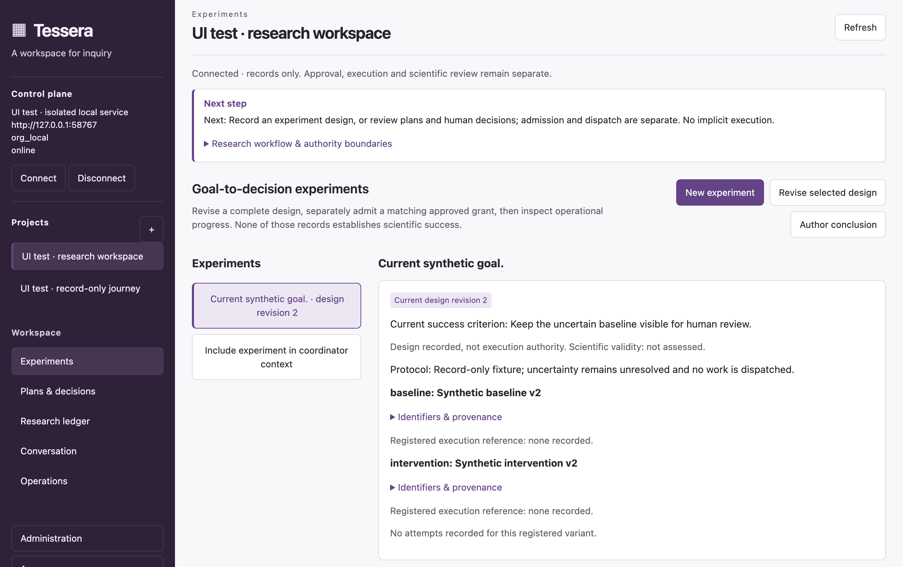
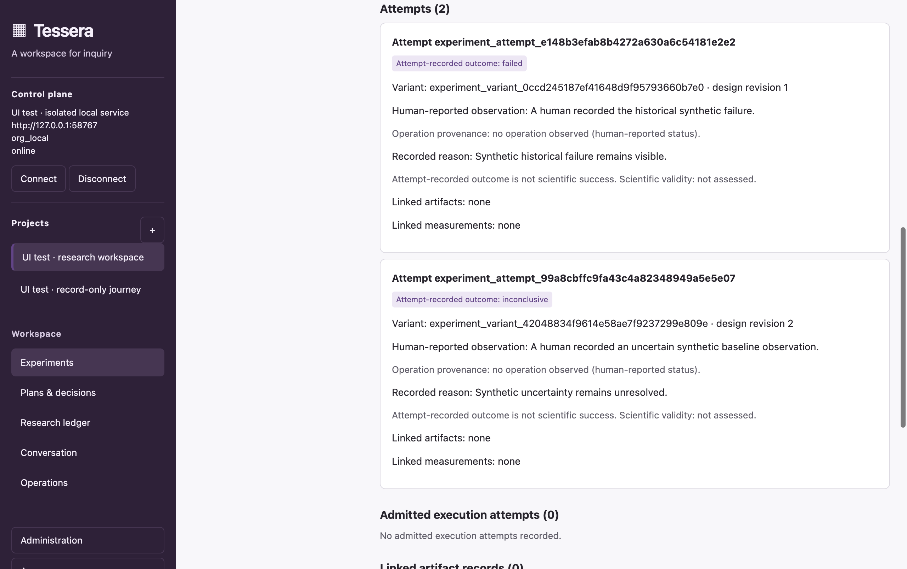
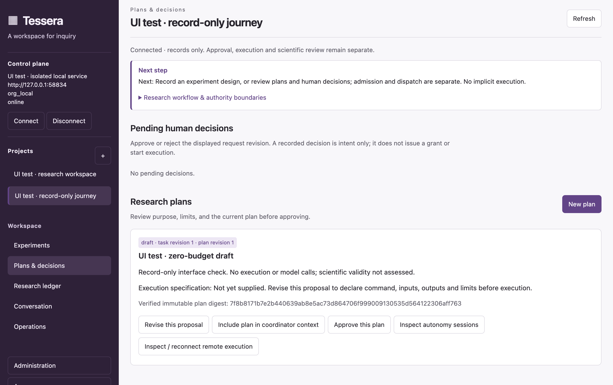
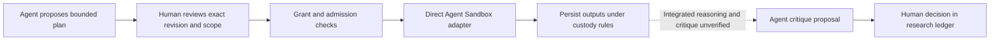

# Tessera

**A research workspace for turning goals into bounded experiments, linked evidence,
and human decisions.** Tessera keeps the design, approvals, attempts, results and
research ledger together—without treating an agent's proposal as permission to run.

**Developer alpha · local evaluation, not a production platform.** The supported
starting point is a local control service and macOS desktop. A bounded CPU baseline
has run on an owned Docker Desktop Kubernetes bench; general remote execution,
integrated agent reasoning and scientific acceptance are not demonstrated.

## A look inside

Actual Electron renderer and real isolated local backend with explicitly synthetic
UI test records. The credential picker is substituted; **no experiment execution
or model calls**. Scientific validity is not assessed. These renderer captures
are not native OS-picker proof.

### Record the experiment design



An immutable design records intent, not execution authority. Provenance and prior
designs remain available without crowding the current research question.

### Keep uncertain observations visible



Historical failure and current uncertainty remain attributed to human-reported
observations. No operation or scientific success is inferred from these records.

### Separate proposals from authority



The test draft survives reload and reconnect without replay. Drafting and human
approval remain distinct from execution admission, dispatch and scientific review.

## Supported workflow

The [quickstart](docs/quickstart.md) follows this bounded local journey. Execution
is a separate API/operator handoff, not a one-click desktop operation.

```mermaid
flowchart LR
  A[Connect to local service] --> B[Project and versioned design]
  B --> C[Separate human approval and execution grant]
  C --> D[Operator admission and CPU baseline dispatch]
  D --> E[Measurements and quarantined artifacts]
  E --> F[Review retention and separate custody release]
  F --> G[Exact result bytes and bundle record export]
  G --> H[Reconnect to durable records]
```



### Agent-assisted research: components, not an integrated demonstration



Proposal/review records and the opt-in [direct Agent Sandbox adapter](docs/agent-sandbox.md)
have isolated component tests. The adapter targets upstream **v1.0.6** one-shot,
network-none Sandboxes; it does not replace batch Jobs. No live CRD/controller or
Sandbox runtime acceptance is claimed. Warm pools, read-only source integration,
input/reasoning credential delivery and a complete agent reasoning/critique loop
are not available in this demonstrated journey.

## Quickstart

Requires macOS, Python 3.11+, uv, Node **22.12.0+** and npm. Python's SQLite must
provide built-in deterministic, innocuous `json_extract` for defensive recovery;
an incompatible build is rejected before control-state writes. See
[runtime prerequisites](CONTRIBUTING.md#setup). In a fresh state directory:

```sh
uv sync --locked --extra mcp
uv run --locked tessera init --state-dir .tessera
uv run --locked tessera serve --state-dir .tessera --port 8765
```

In another terminal:

```sh
npm ci --prefix desktop
npm start --prefix desktop
```

Connect to `http://127.0.0.1:8765` and select the private `.tessera/owner.header`
through the app's file picker; never paste its contents. Initialize only once;
existing state needs the documented backup/migration procedure. Follow the
[screen-by-screen quickstart](docs/quickstart.md) for review/export and troubleshooting.
Native installation and picker/save acceptance require their own checks;
simulator evidence does not close those gates.

## Architecture

**Desktop → control plane → execution plane.** The desktop is a client; the control
service owns revisions, authorization and durable records; workers perform
explicitly admitted execution. Approvals, artifact custody, cost settlement and
scientific acceptance are separate decisions. External trackers are not authority.

See the [documentation guide](docs/README.md) for user, operator and developer
navigation, [capabilities and limits](docs/implemented-capabilities.md) for current
status, and [DESIGN.md](DESIGN.md) for authoritative contracts.

## Limits and safety

- Provider activation is disabled by default; no hosted service or production
  organization authentication is promised.
- Native OS dialogs, independent-host operation, live Sandbox isolation, integrated
  model reasoning, cost settlement and scientific validity need separate evidence.
- Results can be late, quarantined or unclassified even after authorized retrieval.
  Successful execution is not a scientific finding or publication approval.
- This source alpha is not a signed binary release. See the
  [release checklist](docs/release-checklist.md) for remaining gates.

## Contributing and security

Use [CONTRIBUTING.md](CONTRIBUTING.md) for setup, tests and bounded live fixtures.
Read [SECURITY.md](SECURITY.md) before reporting vulnerabilities: do not post secrets,
research data or exploit details publicly; GitHub private vulnerability reporting
is enabled through the repository's Security page. Tessera source is [MIT licensed](LICENSE); bundled
third-party runtimes retain their own license notices.
